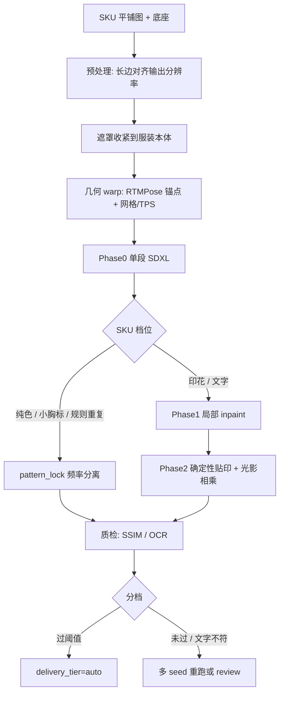

# Print Fidelity Commercial Roadmap

Feature Name: print-fidelity-commercial-roadmap
Updated: 2026-11-09

## Description

把「纯色能过、印花崩」写成商用管线的正式技术路线。诊断来自扩散试衣的结构限制，修复按成本分层：先抬分辨率与遮罩、再两段式局部重绘、最后用确定性几何贴印花，并用 OCR / SSIM 做质检分流。生产路径只使用本仓库已获商用授权或许可证允许商用的组件；学术 VTON 只提供失效机理解释，权重与网络结构不进入代码。

## Architecture

商用引擎的职责切分与学术双通路对应，实现全部落在已有模块上：

| 学术结构（机理对照，不加载） | 本仓库商用落地 |
|---|---|
| 高层语义（品类、廓形、整体识别度） | IP-Adapter `ip-adapter_sdxl_vit-h`（Apache 2.0）喂 warp 后平铺图 |
| 底层细节搬运（纹理、logo、图案） | `_warp_garment` + `reapply_garment_detail` / `_pattern_lock_overlay` |
| 姿态潜变量 | RTMPose 关键点 + ControlNet OpenPose SDXL + Depth ControlNet |
| 遮罩内重绘 | `clothing_mask` ∩ 生成主体 ∩ warp alpha；mask 外 `blend_tryon` 锁身份 |
| 像素空间保高频 | Phase 2 确定性贴印；扩散只出 shading |

## 失效机理（写进路线，指导分层，不引入禁商用代码）

扩散试衣在 VAE 潜空间（SDXL 默认 8x）里把服装 warp 到人体区域再重绘。纯色几乎没有高频，压缩损失可忽略，所以现有管线纯色能过。印花、字母、细密图案全是高频：一压缩、一 warp、一再采样，就被「重新解释」。单张参考 + 自然语言只能锁住粗粒度（颜色、领型、袖长）；印花排布、面料纹理、字母间距、缝合线是模型按先验重画的结果，链路本身不承诺像素级一致。

条件注入也是分层的。IP-Adapter 走 CLIP 高层语义，纯色只靠这一路就够。印花要靠低层通路和姿态条件；warp 对不准就会拉伸、错位、边缘糊。大字号 logo 和成段英文更极端：扩散没有「把这块图贴过去」的算子，只有「这里该有一些白色字母」的先验，字母数、间距、拼写每次都在漂。

三种崩法指向不同环节，质检和修复必须分开：

| 崩法 | 主因 | 主修 |
|---|---|---|
| 文字 / logo 拼写变形 | 扩散在记字母，没有贴图像素 | Phase 2 确定性贴印 + OCR 比对 |
| 图案拉伸、错位、重复 | warp 几何与姿态锚点不准 | 抬分辨率 + TPS/光流升级 + 垂直锚点 |
| 印花边缘糊、和衣身轮廓不对齐 | 遮罩过宽或接缝未修 | 遮罩收紧 + Telea / 局部 inpaint |

## 明确禁止进入生产路径的东西

思路可对照、代码和权重不可用。实现时按这张表卡死：

| 来源 | 许可证 / 形态 | 本路线处理 |
|---|---|---|
| IDM-VTON 微调 UNet / GarmentNet | CC BY-NC-SA 4.0 | 仅作「双通路」概念对照；`LICENSE_MODE=commercial` 不加载 |
| DensePose | 研究用途，商用未授权 | 姿态改用 RTMPose（Apache 2.0）+ ControlNet OpenPose SDXL |
| OpenPose 人体估计原模型 | 文档记为 CC BY-NC-SA | 生产姿态用 RTMPose；ControlNet 条件图用已获商用授权的 SDXL OpenPose 权重 |
| FASHN VTON v1.5 主模型 + `fashn_vton` 代码 | Apache 2.0 | **商用主引擎**（`engine_fashn.py`，像素空间 + TPS，`segmentation_free=True`）；消费级 GPU 可跑 |
| fashn-human-parser（NVIDIA SegFormer 权重） | NVIDIA Source Code License §3.3 含商用限制 | **禁止商用**：`engine_fashn._ensure_parser_stub()` 向 `sys.modules` 注入零张量 stub，权重永不下载 |
| FASHN DWPose / YOLOX 权重 | Apache 2.0 | 允许商用，随 FASHN 权重组下载 |
| DS-VTON / POVNet 官方实现 | 学术代码，未确认商用 | 吸收 coarse-to-fine 与残差高频回收的分层，用自研两段 inpaint + 频率分离实现 |
| 任何 NC / 未获书面授权的权重 | — | 运行时 `engine_status` 不得出现对应路径 |

允许的生产组件（与 README 授权说明一致）：FASHN VTON v1.5 主模型与 `fashn_vton` 代码（Apache 2.0，商用主引擎）、FASHN DWPose / YOLOX 权重（Apache 2.0）、SDXL（已获商用授权）、ControlNet OpenPose/Canny/Depth（已获商用授权）、SDXL Inpainting（与 SDXL 同协议）、IP-Adapter Apache 2.0、RTMPose Apache 2.0、Rembg/U2Net MIT、MediaPipe Apache 2.0 回退、OpenCV 几何、自研 LoRA 与后处理。fashn-human-parser（NVIDIA SegFormer 权重）含商用限制，商用路径注入零张量 stub。

## Components and Interfaces

### Phase 0 — 不重训（挂在 `compose_tryon_sdxl`）

现有管线已经具备遮罩收紧和 pattern_lock。本阶段补齐三件可立即落地的杠杆：

1. **参考图分辨率门闩**  
   `align_garment_to_pose` 的 canvas 与 IP-Adapter / pattern_lock 参考长边跟随 `output_long_side`（默认 2048）。禁止在预处理把平铺图先缩到 512/768 再 warp。实现点：`engine_sdxl.py` 的 `canvas` 参数、`crop_garment_to_content` 之后的缩放。

2. **遮罩继续收紧**  
   保持 `clothing_mask` ∩ `foreground_mask(result)` ∩ warp alpha。短袖/无袖臂肤、脸、背景维持现状。新增：印花 ROI 可从平铺图高频残差估一个子遮罩，供 Phase 1 使用，默认不改变整件 mask。

3. **多 seed + 排序**  
   `VTON_SEED` 今日单值。新增 job 级 `seed_count`（默认纯色 1、印花 3）。worker 对同一 source 跑 N 次，质检分写入 job，UI 只展示最高分。现有 `VTON_SEED` 仍作第一枚种子。

### Phase 1 — 两段式 coarse-to-fine

第一段：现有 SDXL 单次生成，步数可降到 20，只求版型、贴合、光影。  
第二段：`VTON_INPAINT_REPAIR=1` 且已下载 `models/sdxl/sdxl_inpaint/`。把 `_build_inpaint_mask` 从「接缝带 ∪ 肤色异常」扩展为「接缝带 ∪ 印花 ROI」。pipeline 继续走 `_INPAINT_PIPE` 单例，禁止每次 `from_pretrained`。身份锁与肤色校正仍在第二段之前/之后按现序执行，第二段只改 ROI。

这一段对应「低分辨率阶段带来的细节错误用高分辨率局部重绘修」的分层，实现完全复用已落地的 SDXL Inpainting 路径。

### Phase 2 — 确定性贴印（pixel-accurate 的技术支点）

大图案和文字不再交给扩散记。流程：

1. RTMPose 给出肩/腰/髋/腕等锚点；`clothing_mask` 给出衣身轮廓。
2. 在 `_warp_garment` 的网格 remap 上升级：控制点足够时用 OpenCV `cv2.createThinPlateSplineShapeTransformer` 或 Farneback 光流；不够时保持现有水平缩放 + 垂直锚点。
3. warp 后的 SKU RGB 覆盖印花 ROI；生成图只提供低频 shading（现有 `_pattern_lock_overlay` 公式：`lit = LF_ref * shade_lf + HF_ref * shade_hf`）。
4. 元数据 `print_source=sku_warp`。失败则 `print_source=pattern_lock_fallback` 并标 `delivery_tier=review`。

TPS / 光流都是 OpenCV 自带，无第三方 VTON 代码。

### Phase 3 — 质检回环

- 文字款：裁印花 ROI → OCR（优先接已有 OCR 产品；仓库内缺省用 Tesseract Apache 2.0 或 PaddleOCR Apache 2.0）→ 与平铺图 OCR 逐字比。不符则低分，触发下一 seed，上限默认 3。
- 图案款：warp 参考 vs 结果的印花 ROI 做 SSIM（`skimage` BSD 或 OpenCV）。低于阈值进 review。
- 分写入 `jobs[].quality_score` 与 `delivery_tier`。推店接口对 `review` 要求人工确认。

OCR 模型与权重单独进授权表，禁止顺手引入 NC 的识别模型。

## Data Models

Job 增量字段（`state.json -> jobs[]`）：

| Field | Type | Notes |
|---|---|---|
| delivery_tier | string | `auto` / `review` |
| quality_score | float | 0–1，OCR 或 SSIM |
| print_source | string | `sku_warp` / `pattern_lock` / `sdxl_only` |
| seed_used | int | 实际采用的 seed |
| seed_count | int | 本任务尝试次数 |
| ocr_src / ocr_out | string | 平铺图与结果识别文本，可空 |

Settings 增量：

| Field | Type | Default |
|---|---|---|
| print_seed_count | int | 3 |
| print_ssim_threshold | float | 0.72 |
| ocr_mismatch_retry | int | 3 |
| garment_ref_min_long_side | int | 与 `output_long_side` 相同 |

## Correctness Properties

1. **商用加载集封闭**：commercial 模式下进程内不得出现 IDM-VTON / DensePose / fashn-human-parser（NVIDIA SegFormer 权重）模块。FASHN VTON v1.5 主模型与 `fashn_vton` 代码（Apache 2.0）允许商用；DWPose / YOLOX 权重同为 Apache 2.0。
2. **遮罩单调收紧**：apply_mask 像素集合是 clothing_mask 的子集。
3. **文字真值来自 SKU**：`print_source=sku_warp` 时印花 ROI 内字母像素来自 warp 后的平铺图，扩散只乘 shading。
4. **档位诚实**：`delivery_tier=auto` 仅当质检分 ≥ 阈值且 SKU 类属于纯色/小胸标/规则重复印花。
5. **身份锁不变**：mask 外人脸/手/背景仍来自底座原图。
6. **分辨率下界**：输出长边 ≥ 2048；服装参考长边 ≥ `garment_ref_min_long_side`。

## Error Handling

| Scenario | Handling |
|---|---|
| 印花 ROI 估失败 | 退回整件 pattern_lock，tier=review |
| TPS 控制点不足 | 退回现有网格 warp |
| OCR 引擎缺失 | 文字款全部 review，图案款仍走 SSIM |
| Inpaint 权重未下载 | Phase 1 跳过，记 degraded，Phase 0+2 仍可跑 |
| 多 seed 全低分 | job 成功但 tier=review，message 提示精修 |
| commercial 误配 IDM 路径 | engine 拒绝加载，与现有 license gate 一致 |

## Test Strategy

- **许可证**：`LICENSE_MODE=commercial` 下 `engine_status` 不含 idm-vton；单测已有 license gate 保持绿。
- **分辨率**：构造 4096 平铺图，断言 warp 参考长边不低于 settings。
- **遮罩**：短袖样张 apply_mask 与臂肤交集低于阈值（沿用现有肤色测试）。
- **档位**：纯色高 SSIM → auto；OCR 文本不等 → review 且触发 retry。
- **确定性贴印**：人造 logo 字母图 warp 后，结果 ROI 的 OCR 与源图一致（light_strength=0 时像素级接近）。
- **回退**：关掉 inpaint 模型，Phase 1 为 no-op，job 仍 done。
- **回归**：现有 99 pytest + 11 vitest + ruff 必须保持绿。

## Implementation order

按成本从低到高，与需求 Phase 0→3 对齐。每阶段可单独上线。

1. 参考图分辨率门闩 + 印花 ROI 子遮罩 + job 字段 `delivery_tier`。
2. 多 seed worker 与质检分排序（OCR 可后接，先 SSIM）。
3. `_build_inpaint_mask` 并入印花 ROI，打开 `VTON_INPAINT_REPAIR` 作为印花默认。
4. `_warp_garment` TPS/光流升级，pattern_lock 标记 `print_source`。
5. OCR 比对与文案/UI 档位（自动 vs 复核）。
6. 官网/产品文案：pixel-accurate 仅用于 auto 档且质检过线。

## References

- 当前工作区 `/docs/SDXL_PIPELINE.md` — 商用引擎与许可
- 当前工作区 `/docs/LICENSE_COMPLIANCE.md` — NC 门禁
- 当前工作区 `/README.md` — 授权说明与 v0.1.8 后处理顺序
- `backend/engine_sdxl.py` — `compose_tryon_sdxl`、IP-Adapter、inpaint 单例
- `backend/engine.py` — `_warp_garment`
- `backend/platform_presets.py` — `clothing_mask`、`_pattern_lock_overlay`、`_sdxl_inpaint_repair`
- PLTON arXiv:2401.11239 — 频率分离思想（已在 CPU 后处理自研实现，不引入其代码）
