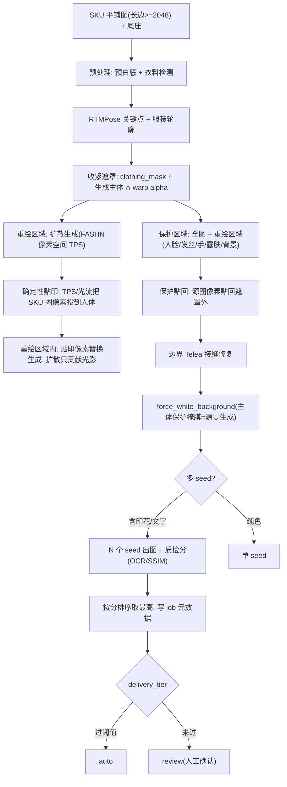

# Print Preservation Refit Pipeline

Feature Name: print-preservation-refit-pipeline
Updated: 2026-11-10

## Description

把「印花/字母由 SKU 平铺图像素构成」落实为管线：重绘部分交给 FASHN VTON v1.5（像素空间 TPS + 扩散），后处理从「遮罩内贴回 + 遮罩外锁身份」翻转为「遮罩外保护贴回 + 遮罩内确定性贴印 + 遮罩外源图像素」。脸、发丝、手臂、胸口背景保持源图像素，遮罩内印花由贴印像素构成，扩散只提供低频光影。多 seed 按质检分排序，参考图长边跟 2048。

## Architecture

| 学术结构（机理对照，不加载） | 本仓库商用落地 |
|---|---|
| 像素空间 TPS 几何对齐 + 扩散 | FASHN VTON v1.5（Apache 2.0）主引擎 |
| 高层语义（品类/廓形） | IP-Adapter `ip-adapter_sdxl_vit-h`（仅 SDXL 兜底路） |
| 底层细节搬运 | 网格/TPS/光流确定性贴印（自研 CPU） |
| 姿态条件 | RTMPose 关键点 + 服装轮廓 |
| 遮罩外保护 | 源图像素贴回 + Telea 边界 |
| 遮罩内高频 | 贴印像素替换扩散输出 |

## Components and Interfaces

### 1. 重绘部分：FASHN VTON v1.5（已有 `backend/engine_fashn.py`）

- `compose_tryon_fashn` 保持 `segmentation_free=True`、`garment_photo_type="flat-lay"`、parser stub。
- 输出像素空间 TPS 对齐 + 扩散生成，高频损失小于 SDXL 潜空间。
- `engine.py` 商用分支已实现 FASHN 优先、异常降级 SDXL。

### 2. 遮罩收紧（已有，需验证）

- 重绘区域 = `clothing_mask` ∩ `foreground_mask` ∩ warp alpha（`intersect_mask_with_garment_alpha`）。
- 现有 `compose_tryon_sdxl` 的 `apply_mask` 就是这个交集，SDXL inpaint hole 也用它。
- 本规格把它定为唯一扩散重绘范围，遮罩外不发扩散。

### 3. 保护贴回（新增 `backend/preserve_refit.py`）

- 函数 `protect_inverse_refit(result, source, recast_mask, feather_px)`：
  - `protect_mask = 全图 − (recast_mask 膨胀 feather_px)`
  - `result[protect_mask] = source[protect_mask]`
  - 边界带（膨胀带 − 未膨胀带）用 `cv2.inpaint TELEA` 平滑。
- 替代现有 `blend_tryon`（遮罩外贴回源图）+ `_seam_repair` 两步为一步。
- 身份锁语义保持：`VTON_LOCK_ID=0` 跳过。

### 4. 确定性贴印（升级 `_warp_garment` 网格 → TPS/光流）

- 现有 `_warp_garment`（cv2.remap 网格）作为回退。
- 升级 `tps_warp(ref_img, src_pts, dst_pts, canvas)`：
  - `src_pts` = SKU 平铺图领口/肩/下摆/袖口锚点（RTMPose 关键点映射 + 服装轮廓采样）。
  - `dst_pts` = 人体对应位置（RTMPose 肩/髋/膝/腕 + 服装轮廓投影）。
  - RBF TPS 解 3x3 仿射 + 径向基，输出 warp canvas。
- 升级 `optical_flow_refit(ref_img, gen_img, mask)`：
  - `cv2.calcOpticalFlowFarneback` 在重绘区域内把贴印像素向生成图褶皱方向微移。
  - 用于贴印后局部对齐褶皱，不引入新像素。
- 参考图长边跟输出 2048，不缩到 1024（IP-Adapter 语义路才缩 1024）。

### 5. 多 seed 排序（新增 `backend/multiseed.py`）

- 函数 `run_multiseed(task_fn, seeds, scorer)`：
  - 对每个 seed 调 `task_fn(seed)` 出图。
  - `scorer` 返回质检分（OCR 逐字比对 或 SSIM）。
  - 返回 `(best_result, all_scores, chosen_seed)`。
- 默认 `VTON_MULTI_SEED=3`，纯色 `=1`。

### 6. 质检（新增 `backend/quality_gate.py`）

- `ocr_score(text_roi_ref, text_roi_out)`：Tesseract/PaddleOCR 逐字比对，返回 0-1。
- `ssim_score(pattern_roi_ref, pattern_roi_out)`：scikit-image SSIM，返回 0-1。
- `delivery_tier(score, threshold)`：`auto` / `review`。
- 写 job 元数据：`delivery_tier`、各 seed 分、chosen_seed。

## Data Models

job 元数据新增字段：

| 字段 | 类型 | 说明 |
|---|---|---|
| `recast_mask` | PNG | 重绘区域掩膜（调试用） |
| `protect_mask` | PNG | 保护区域掩膜（调试用） |
| `refit_engine` | str | `grid` / `tps` / `optical_flow` |
| `multiseed_scores` | list[float] | 各 seed 质检分 |
| `chosen_seed` | int | 选中的 seed |
| `delivery_tier` | str | `auto` / `review` |

## Correctness Properties

1. 保护区域内结果像素 = 源图像素（除 Telea 边界带）。
2. 重绘区域内高频由贴印像素构成，扩散输出只贡献 LF 光影。
3. 贴印参考图长边 ≥ 输出长边，不额外缩到 1024。
4. 多 seed 选中的 seed 质检分 ≥ 其他 seed。
5. `force_white_background` 主体保护掩膜 = 源图主体 ∪ 生成图主体。

## Error Handling

| 场景 | 行为 |
|---|---|
| FASHN 权重缺失 | 降级 SDXL Inpaint，`engine_degraded=True` |
| RTMPose 关键点失败 | 贴印回退网格 remap，job 标 review |
| 贴印轮廓采样 < 8 锚点 | 回退网格 remap + `pattern_lock` |
| OCR 引擎不可用 | 文字类走 SSIM，job 标 review |
| 多 seed 全低分 | 取最高分仍 review |
| Telea 边界带过宽 | 自动收窄到 4px，避免吃进衣身 |

## Test Strategy

- 单测（CPU）：
  - `protect_inverse_refit` 保护区像素 = 源图、重绘区 = 生成、边界 Telea 平滑。
  - `tps_warp` 锚点对齐、回退网格。
  - `run_multiseed` 排序取最高。
  - `quality_gate` OCR/SSIM 分档。
  - 参考图长边 ≥ 2048（mock 检查 resize 尺寸）。
- 集成（GPU）：
  - FASHN 出图 + 保护贴回 + 贴印，肉眼检查脸/发丝/手臂/胸口。
  - 多 seed 印花款排序，OCR 比对文字。
  - 回归：`ruff check` + `pytest tests/ -q` 全绿。

## Environment Variables

| 变量 | 默认 | 说明 |
|---|---|---|
| `VTON_REFIT_ENGINE` | `grid` | 确定性贴印引擎: `grid`/`tps`/`optical_flow` |
| `VTON_PROTECT_FEATHER` | `4` | 保护贴回 Telea 边界带宽度(px) |
| `VTON_MULTI_SEED` | `3` | 多 seed 数量, 纯色款=1 |
| `VTON_QG_SSIM` | `0.70` | SSIM 质检阈值 |
| `VTON_QG_OCR` | `0.80` | OCR 质检阈值 |

## Job Metadata Fields

| 字段 | 类型 | 说明 |
|---|---|---|
| `refit_engine` | str | 实际使用的贴印引擎(grid/tps/optical_flow) |
| `multiseed` | dict | `{n_seeds, seeds, chosen_seed}` |
| `lock_identity` | bool | 保护贴回是否执行 |
| `detail_applied` | bool | pattern_lock 是否执行 |

## References

[^1]: (File) - `backend/engine_fashn.py` FASHN VTON v1.5 引擎
[^2]: (File) - `backend/engine_sdxl.py` SDXL ControlNet Inpaint 兜底
[^3]: (File) - `backend/platform_presets.py` `clothing_mask` / `foreground_mask` / `reapply_garment_detail`
[^4]: (Spec) - `print-fidelity-commercial-roadmap` 印花保真分层路线
[^5]: (License) - FASHN VTON v1.5 Apache 2.0，fashn-human-parser 仍禁
