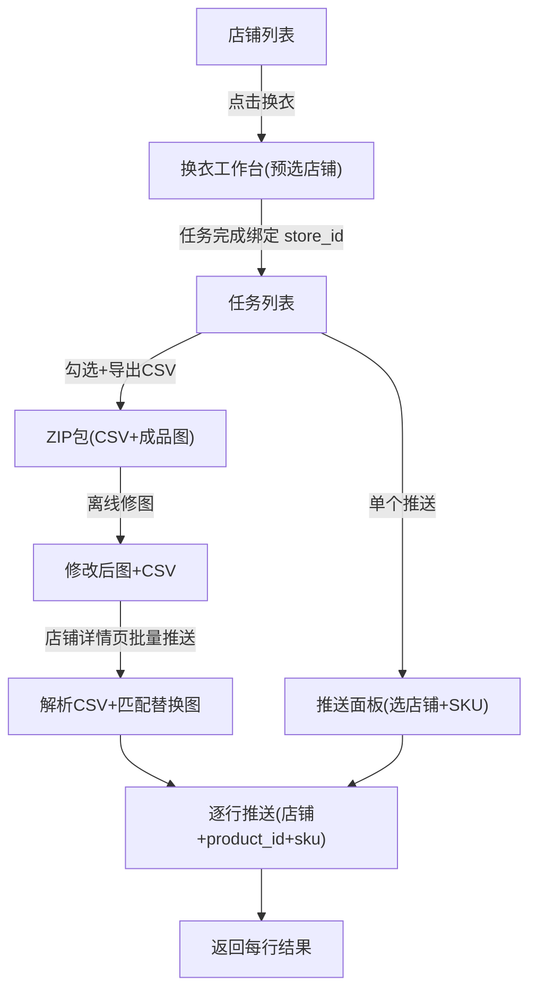

# Store CSV/SKU Workflow

Feature Name: store-csv-sku-workflow
Updated: 2026-10-31

## Description

在现有换衣工作台基础上增加三大功能：(1) 店铺维度换衣入口，任务自动绑定目标店铺；(2) CSV + 图片批量导出/导入，支持离线修图后批量回传推送；(3) SKU 级推送指定（店铺默认 + 每次可覆盖）。形成「换衣 → 导出 CSV+图 → 人工修图 → CSV+图批量推送」的完整工作流。

## Architecture



## Components and Interfaces

### Backend (FastAPI, `backend/`)

#### 数据模型变更

**Store 增加 `default_sku` 字段**（`main.py` StoreBody/StorePatch）：

| 字段 | 类型 | 说明 |
|------|------|------|
| `default_sku` | string | 店铺默认 SKU，推送时回退值 |

**Job 增加 `bound_store_id` 字段**（`store.py`）：

| 字段 | 类型 | 说明 |
|------|------|------|
| `bound_store_id` | string | 店铺维度发起换衣时绑定的店铺 ID |

#### 新增 API

| 接口 | 方法 | 说明 |
|------|------|------|
| `/api/jobs/export-csv` | POST | 入参 `job_ids: list[str]`；返回 ZIP（CSV + 成品图） |
| `/api/stores/{store_id}/batch-push` | POST | multipart 上传 CSV 文件 + 图片包；解析后逐行推送，返回结果数组 |
| `/api/stores/{store_id}` | PATCH | 增加 `default_sku` 字段支持 |

#### CSV 格式

```csv
job_id,image_filename,source_name,store_name,store_id,product_id,sku,status
job_abc123,job_abc123.jpg,tshirt_red.png,旗舰店,store_xxx,prod_001,SKU-RED,done
```

- `image_filename`：ZIP 内实际图片文件名，与成品图一一对应
- `store_id`/`product_id`/`sku`：可留空，导入时店铺详情页入口自动填入 `store_id`
- 用户可离线修改任意列（填 SKU、改 product_id、替换图片文件）

#### 导出流程（`backend/export_csv.py` 新建）

1. 接收 `job_ids`，查每个 job 的 result_path / source_name / bound_store_id / sku
2. 复制成品图到临时目录，按 `job_id.jpg` 命名
3. 生成 CSV，列：`job_id, image_filename, source_name, store_name, store_id, product_id, sku, status`
4. 打包 ZIP（CSV + 所有图），返回 `StreamingResponse`

#### 导入流程（`backend/main.py` 新增端点）

1. 接收 CSV 文件 + 图片文件列表（multipart）
2. 解析 CSV 为行数组
3. 对每行：
   - `store_id` 缺失 → 填入当前店铺 ID（入口在店铺详情页）
   - `image_filename` 在上传包中存在 → 用上传的替换图；否则用原成品图
   - 图片都不存在 → 跳过，标注「图片缺失」
   - 调用 `push_store(job, store, {sku, product_id})` 推送
4. 返回 `[{job_id, ok, message, url}]`

### Frontend (`src/`)

#### 店铺列表页

- 每个店铺卡片增加「换衣」按钮 → 跳转 `/dashboard?store={store_id}`
- 每个店铺卡片增加「批量推送」按钮 → 打开 CSV 上传弹窗

#### 任务列表页

- 批量勾选后增加「导出 CSV」按钮 → 调 `POST /api/jobs/export-csv`，下载 ZIP
- 单个任务「推送」按钮 → 弹出推送选择面板

#### 推送选择面板

- 列出所有店铺，每行显示：店铺名 + `default_product_id` + `default_sku`
- 每行可勾选 + 可临时修改 product_id / sku
- 勾选多个店铺 → 各自推送，各自用其 product_id/sku

#### CSV 上传弹窗（店铺详情页）

- 拖入 CSV 文件 + 图片包（多文件）
- 预览解析结果（表格：job_id / 图片 / SKU / 状态）
- 点击「批量推送」→ 调 `POST /api/stores/{id}/batch-push`

## Data Models

### Store（增量）

| 字段 | 类型 | 默认 | 说明 |
|------|------|------|------|
| `default_sku` | string | `""` | 店铺默认 SKU |

### Job（增量）

| 字段 | 类型 | 默认 | 说明 |
|------|------|------|------|
| `bound_store_id` | string | `""` | 店铺维度发起时绑定的店铺 |

### CSV Manifest

| 列 | 说明 |
|------|------|
| `job_id` | 任务 ID |
| `image_filename` | ZIP 内图片文件名 |
| `source_name` | 原服装图名 |
| `store_name` | 店铺名（可空） |
| `store_id` | 店铺 ID（可空，导入时自动填） |
| `product_id` | 商品 ID（可空，导入时用店铺默认） |
| `sku` | SKU（可空，导入时用店铺默认） |
| `status` | 任务状态 |

### Batch Push Result

```json
[
  {"job_id": "job_xxx", "ok": true, "message": "uploaded", "url": "https://..."},
  {"job_id": "job_yyy", "ok": false, "message": "图片缺失", "url": ""}
]
```

## Correctness Properties

1. **CSV 导出完整性**：ZIP 内图片数量与 CSV 行数一致；每行 `image_filename` 在 ZIP 内存在。
2. **替换图优先**：CSV 行的 `image_filename` 在上传包中存在时，用上传图；否则回退原成品图。
3. **SKU 回退链**：CSV 行 sku > 店铺 default_sku > 空（推送时平台按 product_id 查找）。
4. **店铺绑定保留**：店铺维度发起的换衣任务，`bound_store_id` 持久化，导出 CSV 时写入。
5. **批量推送原子性**：每行独立推送，单行失败不影响其他行；结果数组记录每行状态。
6. **权限**：导出 CSV 需登录；批量推送需 admin；店铺 SKU 配置需 admin。

## Error Handling

| 场景 | 处理 |
|------|------|
| CSV 解析失败 | 返回 400，标注错误行号 |
| CSV 行图片缺失（上传包和原成品都无） | 跳过该行，结果标注「图片缺失」 |
| CSV 行 store_id 缺失 | 店铺详情页入口自动填入当前店铺 |
| 推送时平台返回错误 | 记录到该行结果，不影响其他行 |
| ZIP 导出时任务不存在 | 跳过，不报错 |
| 上传文件非 CSV | 返回 400「请上传 CSV 文件」 |
| CSV 列名不匹配 | 返回 400，列出期望列名 |

## Test Strategy

- **CSV 导出**：勾选 3 个 done 任务导出 ZIP，解压验证 CSV 行数 = 图片数，`image_filename` 与文件一致，未绑定店铺的 store 列为空。
- **CSV 导入**：上传 CSV + 2 张替换图，验证替换图优先于原成品；缺图行跳过并标注。
- **SKU 回退**：CSV 行有 sku → 用行 sku；行 sku 空 + 店铺有 default_sku → 用店铺默认；都空 → 空字符串。
- **店铺换衣入口**：从店铺列表点换衣，job 的 `bound_store_id` = 该店铺 ID。
- **推送面板**：勾选 2 店铺各填不同 sku，验证 push_results 记录各自 sku。
- **权限**：staff 无法批量推送/配置 SKU（403）。

## References

[^1]: (店铺模型) - main.py:196 StoreBody
[^2]: (推送逻辑) - main.py:745 push_job
[^3]: (推送适配器) - push.py:1 push_store
[^4]: (Job 模型) - design.md ../virtual-tryon-dashboard/design.md
