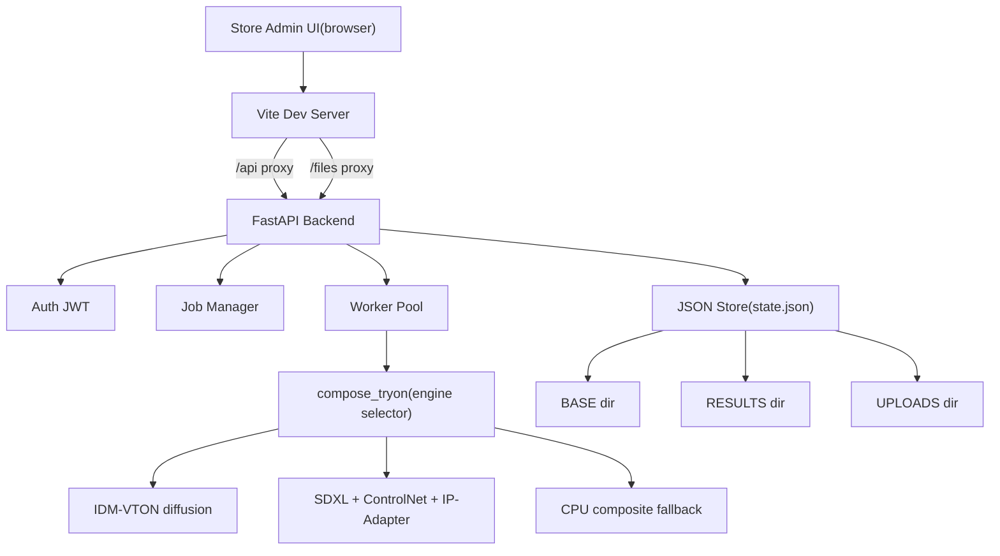

# Virtual Try-On Dashboard

Feature Name: virtual-tryon-dashboard
Updated: 2026-10-25

## Description

A browser-based virtual try-on dashboard embedded in an existing e-commerce clothing store admin. Admin staff drag-and-drop garment flat-lays or ghost-mannequin shots, watch a parallel processing queue, and download or push finished front-facing model photos. Server-side generation runs on the merchant's cloud account with a swappable AI engine: IDM-VTON diffusion pipeline for research use, SDXL + ControlNet + IP-Adapter for commercial use, and a CPU-composite fallback for GPU-less environments.

## Architecture



## Components and Interfaces

### Frontend (Vite SPA, `src/`)
- `src/main.js` — single-file admin SPA: login, dashboard, batch upload, base selection, queue, upload library with categories, license banner, preview modal.
- `src/style.css` — UI styling.
- `vite.config.js` — dev server with `/api` and `/files` proxy to backend, `allowedHosts` for `*.monkeycode-ai.online`.
- `public/embed.html`, `public/widget.js` — iframe embed entry.

### Backend (FastAPI, `backend/`)
- `backend/main.py` — FastAPI app; mounts `/files` serving with recursive fallback for uploads moved into category subdirectories.
- `backend/auth.py` — JWT authentication.
- `backend/store.py` — JSON-backed state, path constants (`UPLOADS`, `RESULTS`, `BASES`, `TRASH`), `find_in_dir` helper for cross-subdirectory lookup, `public_url`.
- `backend/worker.py` — parallel worker pool (`WorkerPool`, N daemon threads). Each worker atomically claims a queued job via `store.claim_next_job` and processes it. Default worker count is `min(WORKERS env, os.cpu_count())`, resolves source file via `find_in_dir`.
- `backend/engine.py` — engine selector (`compose_tryon`), IDM-VTON wrapper, composite fallback, license gating (`LICENSE_MODE`).
- `backend/engine_sdxl.py` — SDXL + ControlNet + IP-Adapter commercial pipeline.
- `backend/start.sh` — single-command backend launch (`uvicorn main:app`).

### Data flow
1. Staff logs in via `POST /api/auth/login`, receives JWT.
2. Staff uploads batch via `POST /api/jobs/batch`; backend stores each source under `UPLOADS/{uid('src')}_{name}` and creates a job.
3. Each worker in the pool atomically claims the next queued job via `store.claim_next_job` (which flips the job to `running` under an exclusive lock, so no job is claimed twice). It resolves base and source (with `find_in_dir` fallback), calls `compose_tryon`, writes result to `RESULTS/{job_id}.{ext}` and preview to `RESULTS/{job_id}_preview.jpg`.
4. UI polls `/api/jobs` every 5s; done jobs expose `result_url` / `preview_url`; staff download via `/api/download/{job_id}` or push via `POST /api/jobs/{job_id}/push`.

## Data Models

### Job (`state.json -> jobs[]`)
| Field | Type | Notes |
|-------|------|-------|
| id | string | `job_{uuid12}` |
| base_id | string | FK to base |
| audience | string | auto/women/men/girls/boys/baby |
| garment_type | string | auto/upper/lower/full |
| output_format | string | jpg/png |
| background | string | white/transparent |
| source_name | string | original filename |
| source_url | string | /files/uploads/... |
| status | string | queued/running/done/failed |
| progress | int | 0-100 |
| message | string | human-readable progress |
| result_url / preview_url | string | output paths |
| title, sku, pushed | string/bool | product page metadata |

### Base (`state.json -> bases[]`)
| Field | Type | Notes |
|-------|------|-------|
| id | string | e.g. base_women_01 |
| name | string | display name |
| audience | string | women/men/... |
| age_band | string | adult/baby/toddler/child |
| pose | string | front |
| file | string | filename under `BASES` |
| active, builtin | bool | management flags |

### Setting (`state.json -> settings`)
- `output_long_side` (int, default 2048)
- `background` (white/transparent)
- `engine` (idm-vton-composite / sdxl-commercial / composite)
- `store_name`, `webhook_url`

## Correctness Properties

1. **Single output**: one job yields exactly one output image; no side/back views generated.
2. **Longest side >= 2048**: enforced via `long_side = int(cfg["output_long_side"])` passed to `compose_tryon` (worker.py:44).
3. **Background fidelity**: transparent requires PNG with alpha; white yields RGB JPEG `quality=94`.
4. **File resolution**: source lookup falls back across upload subdirectories so moves into categories never orphan a queued job (worker.py:23-30).
5. **License gate**: `commercial_compliant` is true only when running the SDXL commercial engine; IDM-VTON is disabled when `LICENSE_MODE=commercial` (engine.py).
6. **Concurrency**: each worker independently claims the next queued job via `claim_next_job` (atomic under exclusive lock in `store.py`); independent jobs run in parallel up to `WORKERS` slots; queue order preserved since each claim picks the next queued job.
7. **State durability**: `state.json` writes are serialized by a cross-process `fcntl.flock` on `state.lock` and written to a unique per-process tmp file then atomically renamed, so concurrent API/worker processes never corrupt the store.

## Error Handling

| Scenario | Handling |
|----------|----------|
| Wrong credentials | `401` with generic message, no field disclosure |
| Base missing | job fails with "未找到指定模特底座" |
| Source image missing | job fails with "服装原图不存在" |
| Base file missing | job fails with "模特底图文件缺失，请先上传底座" |
| Commercial mode without SDXL | `compose_tryon` raises `RuntimeError`, job marked failed |
| File not found in `/files` | `404` after recursive fallback search |
| Push before done | `400` "仅已完成的成品可推送到商品页" |
| Job unknown | `404` "任务不存在" |

## Test Strategy

- **Auth**: login success, wrong password, missing/invalid token on protected routes.
- **Upload batch**: valid images create N jobs; unsupported formats rejected with names.
- **Queue poll**: state transitions queued -> running -> done/failed with progress monotonic updates.
- **Output spec**: PNG alpha when transparent; JPEG RGB when white; image longest side >= 2048.
- **File resolution**: move a source to category subdir, confirm queued job still resolves and completes.
- **License gate**: `LICENSE_MODE=commercial` without SDXL weights returns no-compliant-engine and job failure with clear message.
- **Cleanup targets**: no engine downloads in unit tests; isolates target dirs.

## References

[^1]: (README) - [README.md](../README.md)
[^2]: (backend entry) - [main.py](design-ref-main.md)
[^3]: (worker loop) - [worker.py](../worker.py)
[^4]: (engine selector) - [engine.py](./engine.py)
[^5]: (SDXL pipeline) - [engine_sdxl.py](./engine_sdxl.py)
[^6]: (store/state) - [store.py](./store.py)

## LoRA Training Baseline and Retraining Plan

### Current Training State (v0.1.2 checkpoint)

The deployed LoRA adapter (`models/sdxl/lora/adapter_model.safetensors`, 93 MB, PEFT format, r16/alpha16, targets to_q/to_k/to_v/to_out.0) was trained on 25 images (16 cloth flat-lays + 9 human models) for 800 steps in bf16 on an A10 (peak 14.8 GB), using diffusers 0.40. The training log (`training/train_log.md`) records three bug fixes applied during that run: transformers 5.x pooler incompatibility, fp16→bf16 NaN, and CSV quote escaping.

### Geometry Fixes Already Applied (retraining baseline)

The following fixes are landed in `training/train_lora_sdxl.py` / `train_controlnet_sdxl.py` and form the baseline for the next retraining run. They were not present in the v0.1.2 checkpoint, so a retrain is required to bake them into the weights:

1. **time_ids correction**: `[res, res, res, res, 0, 0]` → `[res, res, 0, 0, res, res]` (original/crop/target ordering per SDXL UNet convention).
2. **Letterbox instead of hard stretch**: `letterbox_rgb` preserves aspect ratio with padding; `VTON_AR` defaults to on at inference.
3. **VAE fp32 encoding**: VAE moved to float32 with `no_grad` for encode, preventing bf16 latent artifacts.
4. **Min-SNR weighting**: Kohya `min(snr, gamma)/snr` with `--snr_gamma 5.0` (suppresses high-SNR/low-noise steps).
5. **Dual-format save**: training now writes both `adapter_model.safetensors` (PEFT, authoritative) and `pytorch_lora_weights.safetensors` (diffusers) from the same checkpoint; `lora_io` prefers PEFT.

### Retraining TODO (requires GPU)

The v0.1.2 checkpoint has two quality bottlenecks that cannot be fixed by geometry alone and require a retraining run on a GPU (e.g. ModelScope A10):

| Issue | Current | Target |
|-------|---------|--------|
| Caption diversity | Only 2 template sentences (one for cloth, one for human), shared across all 25 images | Per-image captions describing color, garment category, fabric, and notable details |
| Training groups | cloth + human mixed in a single adapter | `GROUPS=human` only (human-pose-conditioned adapter); cloth remains as IP-Adapter reference, not a trained class |

**Next retraining command:**

```bash
MODEL=lora_family GROUPS=human bash training/run_train.sh
```

**Caption rewrite requirement:** before retraining, replace the 2 template captions in `training/dataset/` with per-image descriptions. Each caption should cover:
- Color (e.g. "charcoal grey", "ivory white")
- Garment category (e.g. "crew-neck t-shirt", "pleated midi skirt")
- Fabric (e.g. "cotton jersey", "silk twill")
- Notable detail if present (e.g. "ribbed cuffs", "concealed back zip")

This retrain is blocked on GPU availability and is not actionable in the CPU-only development environment.